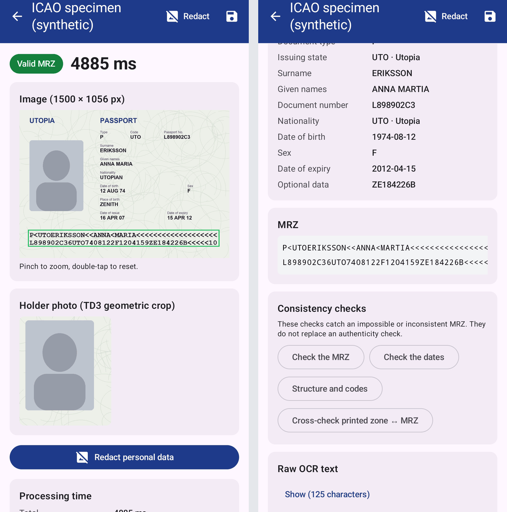
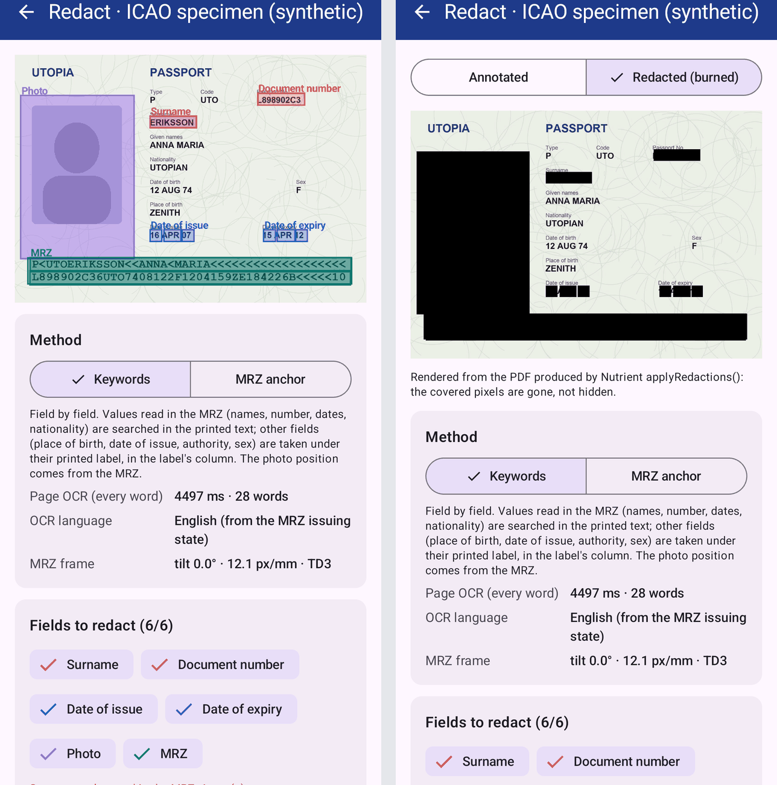
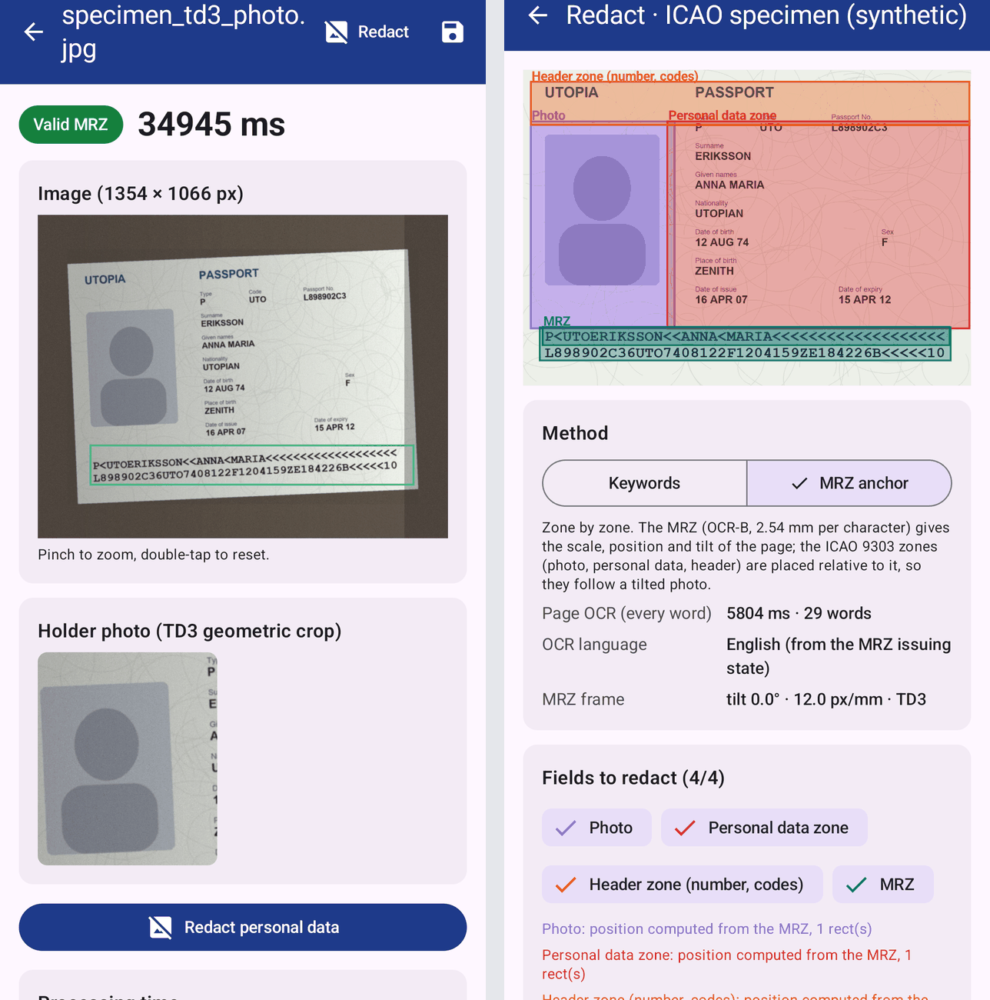

# Nutrient MRZ Reader for Android

A Nutrient.io demo that reads the machine-readable zone (MRZ) of passports and ID cards entirely on an Android device with the Nutrient Android SDK OCR, then redacts the holder's personal data with Nutrient redaction annotations.



1. **Input.** A camera capture (auto capture when the same valid MRZ is read twice in a row), an image opened or shared to the app, a folder of images (batch mode), or the built-in synthetic specimen.
2. **OCR.** The image is wrapped in a one-page PDF and read with the Nutrient Android OCR (`PdfProcessorTask.performOcrOnPages`). The OCR runs in a separate process, so a native crash on one image only fails one attempt.
3. **MRZ rules.** An ICAO 9303 rule engine written for this demo fixes typical OCR errors (fillers, look-alike characters, merged lines), checks every check digit, and picks the format (TD1, TD2 or TD3). Each fix is listed on screen.
4. **Checks.** Dates, country codes and structure are checked, and the MRZ is cross-checked with the printed zone.
5. **Redaction.** The page is OCR'd word by word, the regions to hide are planned (by keywords or by MRZ geometry), each region becomes a Nutrient `RedactionAnnotation`, and `PdfProcessorTask.applyRedactions()` removes the covered content.

The app declares no `INTERNET` permission. Nothing leaves the device.

## Features

| Feature | Where |
|---|---|
| Camera scan with auto capture | Home, Scan with the camera |
| Open an image, or share one to the app from Photos or Files | Home, Open an image |
| Batch mode: a folder of images, statistics (valid MRZ rate, average, median and p95 time), CSV and JSON export | Home, Batch mode |
| Any orientation: upright, upside down, portrait; the document is shown upright | Automatic |
| Processing time per step and per attempt | Result screen |
| Extracted fields, MRZ lines with the characters fixed by the rules highlighted | Result screen |
| MRZ, date, structure and printed-zone checks | Result screen |
| Holder photo cropped from the MRZ geometry (TD3) | Result screen |
| Redaction by keywords or by MRZ anchor, reviewable, burned with Nutrient, PDF and PNG export | Result screen, Redact |
| Nutrient license key entered in the app | Settings |

## Redaction methods

**Keywords (field by field)**

- Values read in the MRZ (surname, given names, document number, dates, nationality, personal number) are searched in the printed text, tolerating OCR errors.
- Fields that are not in the MRZ (place of birth, date of issue, authority, sex) are found under their printed label: the value is the next text line, inside the label's column.
- Passports print labels in the issuing state's language as well as English or French. The label tables in `RedactionPlanner.kt` therefore also contain French, German, Spanish, Italian, Dutch, Portuguese, Polish, Turkish and Nordic labels, and printed dates are matched with English and French month abbreviations.
- The photo has no text: its position comes from the MRZ geometry.

**MRZ anchor (zone by zone)**

- ICAO 9303 fixes the OCR-B pitch at 2.54 mm per character. From the OCR boxes of the first and last characters of each MRZ line, the app computes an MRZ frame: position, scale (px/mm) and tilt of the page.
- The ICAO zones of the format (TD3: photo, personal data, header; TD1 back: everything above the MRZ) are placed in that frame, so they follow the distance, position and tilt of the photo.
- Redaction rectangles are axis-aligned: a tilted zone is covered by horizontal strips.

**Annotate, then burn**

1. The preview shows every planned region, one color per field. Each field can be turned off.
2. **Burn redactions with Nutrient** turns each region into a `RedactionAnnotation` and applies it. The "Redacted (burned)" view is rendered from the output PDF.
3. **Review in Nutrient viewer** opens the annotated PDF in the Nutrient viewer, where redactions can be moved, resized, added and applied.
4. Exports: redacted PDF, redacted PNG, annotated PDF.

## OCR languages

The MRZ is always read with the English model. The page OCR (redaction, printed-zone cross-check) uses the model of the issuing state among the 21 Nutrient Android OCR languages: English, French, German, Spanish, Italian, Dutch, Portuguese, Polish, Turkish, Czech, Slovak, Slovenian, Croatian, Serbian, Danish, Norwegian, Swedish, Finnish, Indonesian, Malay and Welsh (`OcrLanguages.kt`). There is no Arabic, Cyrillic or Chinese model: those documents use English, which still reads their Latin-script fields. The language packs add about 40 MB to the APK.

## Prerequisites

- Android Studio, or JDK 17 or later and the Android SDK (compile SDK 36)
- An Android 8.0 (API 26) or later device, or an emulator (arm64 or x86_64)
- Python 3 with Pillow, only to regenerate the specimens
- Access to the Nutrient Maven repository (`https://my.nutrient.io/maven/`), declared in `settings.gradle.kts`

## Environment variables

Start from `.env.example`.

| Variable | Purpose | Default |
|---|---|---|
| `NUTRIENT_LICENSE_KEY` | Nutrient Android SDK license key, bound to the application ID `io.nutrient.poc.mrz`. Read at build time. | empty = evaluation mode |

You can also put `nutrient.licenseKey=<key>` in `local.properties` (git-ignored), or enter a key at run time in **Settings, License key**. Never commit a key.

In evaluation mode the SDK stamps a red "For Evaluation Purposes Only" banner across every page given to the OCR, and stops the app after 60 minutes. The banner lowers OCR accuracy, especially on a cropped MRZ band, and shows on the redacted output. Burning redactions needs the Redaction and Annotation Editing components.

## Build and run

```bash
./gradlew :app:assembleDebug
```

```bash
adb install -r app/build/outputs/apk/debug/app-debug.apk
```

Or open the folder in Android Studio and run the `app` configuration.

Unit tests of the MRZ rules and the redaction planner (JVM, no device):

```bash
./gradlew :app:testDebugUnitTest
```

On-device tests with the real Nutrient OCR on the specimens in `app/src/androidTest/assets`:

```bash
./gradlew :app:connectedDebugAndroidTest -Pandroid.testInstrumentationRunnerArguments.class=io.nutrient.poc.mrz.PipelineOnDeviceTest
```

## Using the app

1. Tap **Try the built-in specimen**, **Open an image**, or **Scan with the camera**.
2. The result screen shows the status (valid MRZ or not), the time per step and per attempt, the MRZ box, the holder photo, the extracted fields and the MRZ lines.
3. Tap **Redact**. Pick **Keywords** or **MRZ anchor**, turn fields on or off, then tap **Burn redactions with Nutrient**.

   

   On this synthetic specimen the page OCR reads only part of the printed zone, so the keyword method misses some fields (given names, nationality, date of birth). The MRZ anchor method covers the whole personal data zone by geometry.

4. A phone-like photo (tilt, blur, uneven light) is read too, and the MRZ anchor zones follow the page.

   

Screenshots 01 and 02 were taken on an Android emulator with a license key; 03 in evaluation mode. All documents shown are the synthetic specimens of this repository.

To open your own image from a computer (device connected over USB, or the emulator):

```bash
tools/process-image.sh path/to/passport.jpg
```

Add `--redact` to go straight to the redaction screen.

## Specimens

`tools/make_specimens.py` draws synthetic documents with the ICAO 9303 specimen data (state "Utopia", fictitious holder Anna Maria Eriksson): a clean TD3 data page, a phone-like photo, a portrait tilted photo, a TD1 card back and an image without MRZ. The files in `specimens/` and the app assets are its output.

```bash
python3 tools/make_specimens.py specimens
```

The script uses the macOS Courier New Bold and Arial fonts. On other systems, set `SPECIMEN_FONT_DIR` to a folder with the same `.ttf` files.

## Benchmark and redaction audit on your own images

The on-device tests below read every image in the app's external `testset` folder. Put your own images there (the `testset/` folder at the repository root is git-ignored).

```bash
adb push testset/. /sdcard/Android/data/io.nutrient.poc.mrz/files/testset/
```

MRZ benchmark (results in `adb logcat -s MrzBench` and `files/bench.tsv` on the device):

```bash
./gradlew :app:connectedDebugAndroidTest -Pandroid.testInstrumentationRunnerArguments.class=io.nutrient.poc.mrz.TestsetOnDeviceTest
```

Redaction audit (both methods, one JSON and one upright image per document):

```bash
./gradlew :app:connectedDebugAndroidTest -Pandroid.testInstrumentationRunnerArguments.class=io.nutrient.poc.mrz.RedactionAuditTest
```

```bash
adb pull /sdcard/Android/data/io.nutrient.poc.mrz/files/audit audit/
```

```bash
python3 tools/render_audit.py audit/audit
```

`audit/audit/review/*.png` shows, per image, the OCR words, the MRZ frame, and the keyword and MRZ anchor regions side by side. To iterate on the planner without a device, replay the captured OCR on the JVM:

```bash
AUDIT_DIR=audit/audit ./gradlew :app:testDebugUnitTest --tests '*AuditReplayTest*'
```

## MRZ rules

The Nutrient OCR is a general-purpose OCR (Tesseract, English model), not an MRZ engine. The rules fix its typical errors:

1. **Fillers**: `<` read as `K`, `L` or `«` inside a run of fillers becomes `<` again.
2. **Surname separator**: `<<` read as `K<` or `<K` is restored.
3. **Merged lines**: two MRZ lines returned as one OCR line are split.
4. **Re-alignment**: the data line is anchored on birth date, sex and expiry date; an extra or missing character is fixed by choosing the variant with a real ICAO country code and a valid check digit.
5. **Typing by position**: where digits are expected, `O` becomes `0`, `S` becomes `5`, `B` becomes `8`, and the reverse where letters are expected.
6. **Check digits**: for the document and personal numbers, look-alikes (O/0, I/1, L/1, S/5, B/8, Z/2, G/6) are tried; among the variants that pass, the fewest changes win.
7. **Format choice**: most valid check digits, then the format whose line length best matches the OCR.

## Known limits

- **L and 1 in the document number** give the same check digit (their ICAO values differ by 20), so no check digit can tell them apart. The printed-zone cross-check catches it. Names carry no check digit at all.
- **Keyword redaction depends on the page OCR.** On small or low-contrast images, and under the evaluation banner, many labels are not read and fields are missed. The MRZ anchor method covers them by zone.
- **MRZ anchor zones** follow the ICAO layouts; national designs vary, so the zones are generous. Perspective is not corrected.
- **Native OCR crashes**: some images make the OCR of SDK 11.7.0 crash natively. The OCR therefore runs in its own process and a failed attempt is retried once with a white margin around the image.
- **First call** takes about 3 to 4 seconds more while the OCR process starts.
- No NFC chip reading, no forgery detection.

## Project layout

| Path | Content |
|---|---|
| `app/src/main/java/io/nutrient/poc/mrz/mrz` | MRZ extraction, parsing and ICAO checks (pure Kotlin) |
| `app/src/main/java/io/nutrient/poc/mrz/redact` | MRZ frame geometry, redaction planner, Nutrient redaction burner |
| `app/src/main/java/io/nutrient/poc/mrz/ocr` | Nutrient OCR engine, OCR service process and client, image preparation |
| `app/src/main/java/io/nutrient/poc/mrz/pipeline` | Preprocessing strategies, timings, MRZ box, photo crop |
| `app/src/main/java/io/nutrient/poc/mrz/batch` | Batch mode, statistics, exports |
| `app/src/main/java/io/nutrient/poc/mrz/ui` | Compose screens |
| `app/src/test`, `app/src/androidTest` | JVM and on-device tests |
| `tools` | Specimen generator, image push script, audit renderer |
| `specimens` | Synthetic specimen images |
